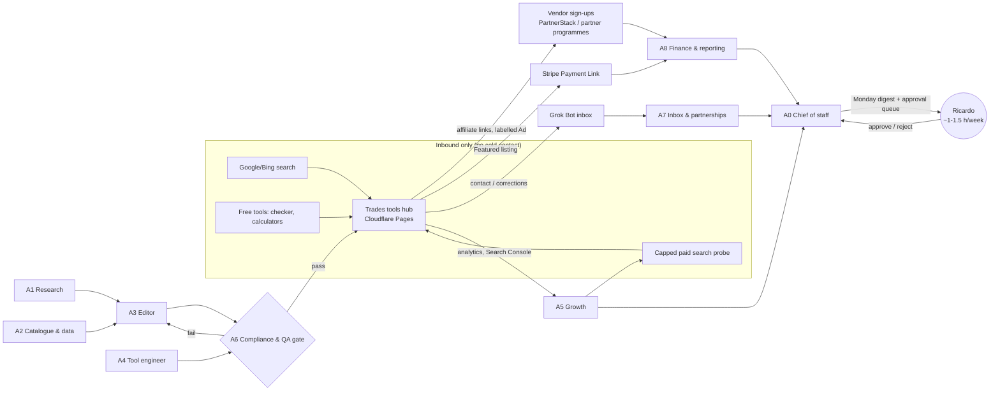

# Plan: a fully automated side hustle run by an AI agent team

**For:** Ricardo Costa (Bromley; evenings around a toddler; technical; wants agents to do almost everything, with him reviewing and approving).
**Date:** 22 Oct 2026. **Branch:** `plan-fully-automated-agent-team`.
**Inputs:** `analysis/all_ideas_ranked.json` (227 ideas, 316 transcripts), `plans/trades-missed-call-ai-plan.md`, `tools/chat_widget_scanner.py`, the playbooks, a keyword skim of the 119 unmined transcripts (§1.3), and web checks on 22 Oct 2026 (URLs inline).
**Conventions:** quotes and revenue figures from videos are **claims** by the speaker, not audited. My own estimates and judgements are marked **[E]**. Every rubric score is a judgement [E].

---

## Bottom line

- **Pick: a UK "trades tools hub".** It's a website that gives UK tradespeople free tools: a checker for "does my website catch enquiries when I miss the call?" (the scanner we already built), a missed-call cost calculator and simple trade calculators. It also has honest comparison pages for trades software: AI receptionists, missed-call text-back, and job-management apps. Money comes from **affiliate commissions**. Display ads and paid "featured" vendor listings come later, through Stripe. Visitors arrive through search and the free tools, so **nobody gets cold-contacted** and PECR doesn't come into it. Building, publishing, measuring and support can all be run by agents.
- **Runner-up: a self-serve "website-gap" lead finder for AI and web agencies.** The scanner becomes an Apify Store actor plus a small credit-based web app. It brings in money faster and has paying customers directly, but it's crowded (similar actors cost $2 per 1,000 domains) and acquisition is only partly automatable.
- **Honest caveats.**
  1. Search traffic takes months, so 6 weeks can only test whether people **click through and sign up through the affiliate links**, using a capped £100 paid-search probe. It can't test organic income.
  2. Comparison sites for this niche **already exist**: ringverity.co.uk, keepbooked.co.uk, m1studio.co.uk and systemiseyourtrade.com. The edge has to come from the free tools and the scan data we collect ourselves.
  3. Affiliate payouts per referral are small, for example Trade Receptionist's "£7.35–£23.85/month" per client, so it only works at volume.
- **What Ricardo still does:** about 5 h in week 1 (accounts, identity checks, legal sign-off), then **about 1–1.5 h a week** to approve the queue and read the Monday digest [E].
- **Budget:** about £200 over 6 weeks, hard cap £300 (§5.4).

---

## 1. Which ideas can actually be fully automated?

### 1.1 Rubric

Each idea is scored 1–5 on seven automation criteria. 5 means "an agent team can do it alone, legally, in the UK":

| Code | Criterion | 5 means |
|---|---|---|
| Acq | Customer acquisition without Ricardo | Inbound or self-serve only: SEO, marketplaces (Apify Store, Shopify App Store, Chrome Web Store), content, capped paid ads, tools. **No** cold SMS, WhatsApp, DMs or emails to sole traders; ICO says DMs and texts count as "electronic mail" ([ICO B2B](https://ico.org.uk/for-organisations/direct-marketing-and-privacy-and-electronic-communications/business-to-business-marketing/)) |
| Onb | Onboarding | Self-serve; no call |
| Del | Delivery | Software or API only; no human labour |
| Bill | Billing | Stripe or a marketplace or affiliate network pays out automatically |
| Sup | Support load | Close to zero, and an agent can answer it |
| Legal | Legal and ToS risk | No scraping of platforms whose terms forbid it, no personal-data resale, no regulated claims |
| Time | Ricardo's hours once running | Under 2 h a week |

**Auto** is the mean of the seven. **Combined** = 0.5 × the existing ranking score (value, revenue probability and so on, from `all_ideas_ranked.json`) + 0.5 × Auto. An idea only counts as "fully automatable" if **Acq ≥ 4**.

### 1.2 Results: top 42 ranked ideas plus 2 pivots, sorted by Combined

Full table in Appendix A. Highlights:

| # | Idea (ranking #) | Combined | Acq | Can acquisition be fully automated? |
|---:|---|---:|---:|---|
| 1 | Niche utility/calculator sites (#28) | 4.19 | 4 | **Yes**: SEO and the tool itself. Income is display ads, a low amount per visitor |
| 2 | Niche daily web game network (#14) | 4.19 | 3 | **Partly**: it depends on going viral; "hit-driven" (card risk) |
| 3 | Niche calculator site with display ads (#35) | 4.16 | 4 | **Yes**, but AI Overviews can answer simple calculations directly (card risk) |
| 4 | **N1 Trades tools hub: checker, calculators, comparison (pivot)** | 4.16 | 4 | **Yes**: search, free tools, capped paid search. Monetised through affiliates with much higher value per referral than ad income per visit |
| 5 | **N2 Website-gap lead finder for agencies (pivot)** | 4.15 | 3 | **Partly**: Apify Store traffic is inbound, but the store is crowded; growth outside the store needs content or ads |
| 6–7 | Apify actor wrapper / Maps lead scraper (#2/#3) | 4.08 | 3 | **Partly**. Nico's growth was word of mouth (`50iWtrj9Mkw`). Google Maps data carries ToS and UK GDPR risk |
| 8 | Niche directory (#20) | 4.02 | 4 | **Yes** (SEO). N1 is a directory of this type |
| 10 | Amazon review intelligence (#7) | 4.00 | 3 | **Partly**. Scraping Amazon is a ToS risk (card risk) |
| 20 | Build-first websites (#1) | 3.53 | 1 | **No**. Needs walk-ins, post or calls; cold texts to sole traders are illegal |
| 24 | AI missed-call text-back for trades (#22) | 3.38 | 1 | **No**. Same reason; the earlier plan relies on Ricardo's calls, post and visits |
| — | Cleaning and home-service brands (#4, #5, #15, #29, #42) | ≤3.22 | 3 | Ads can be automated; **delivery is people** |

**Conclusion:** every idea with Acq ≥ 4 is a **search-led site**: calculators, directories, or the N1 hybrid. Anything sold to local trades through outreach (#1, #9, #12, #22, #25) fails the full-automation test under UK rules.

### 1.3 State of the corpus and unmined transcripts

- `state.md` disagrees with itself. The header says "119 new transcripts await mining", but the table says "New transcripts awaiting mining: 0" and "Transcripts mined into ideas: 316". I checked: the 119 transcripts added in commit `95a28e5` have **no** video ID cited anywhere under `analysis/`, so they are **not mined**. The ranking still covers 227 ideas from 316 transcripts.
- I keyword-skimmed the unmined ones for fully automated models instead of re-mining them. The relevant ones are all directories and SEO tools, which back up N1:
  - `SiRlIMtZygI` (*He Makes $3M/Year From Tiny AI Tools*). The guest, John, claims "around 3 million" combined across 24 projects, and "most of my directories are making 1K a month. Some make 10K." He says SEO Bot is "1 million AR… 110k a month", and one tactic is affiliate partners. Claims.
  - `1fTGX4sLVqA` (*The Most Overlooked Way to Make Money On the Internet*). A directory builder claims "completely passively… $2,300 to $3,000 a month" from his directories, and that one $50 backlink led to "two years worth of… $2,000 a month". He also warns that selling sponsorships turns it into "a sales business… that's a grind". Claims.
  - `g5Vd0-y3rG8` (*The Most Passive Online Business No One Talks About*): directories earn from "ad revenue, affiliate clicks, paid placement, lead gen forms", with a suggestion to "charge vendors a flat 20 bucks a month". No revenue shown.
  - `abeY8nBzqzo` (*The Most Copy-Pastable Online Business*): a vibe-coded directory "probably just doing like maybe $7, $800 a month", with no ads. Claim.
  - `LZ_bjRV6xx0` (*The Most Hands-Off Side Hustle*): a niche-site owner claims "about $50,000 a year from one hour per month of work".
  - Other possibly relevant ones I didn't mine: `HWPQPTOG6Ew` (white-label HighLevel SaaS; needs sales), `bH_coG-2ASo` (cloning SaaS; lead scraping), `xc2IjVqVdQY` and `Y0MRAjVp_Uo` (newsletters), `cBdJajFcSzg` (digital products), `AA-EL571oG4` (an agent that "works while I sleep"). **Recommendation:** run a proper v6 mining pass later and fix the `state.md` table.

---

## 2. The pick and the runner-up

### 2.1 Pick: UK trades tools hub (N1)

**What it is:** one site, for example `[name].co.uk`. The domain is Ricardo's choice. It has three sections:
1. **Free tools.** These are the pull for search and sharing.
   - *Website enquiry checker:* paste your URL to see whether your site has chat, booking, WhatsApp, a form and click-to-call, and what happens out of hours. It runs `tools/chat_widget_scanner.py` as a Cloudflare Worker or Apify actor, and only scans the URL the visitor asks for.
   - *Missed-call cost calculator:* calls missed per week × conversion × job value. The visitor enters the inputs; we supply none.
   - Two or three trade calculators of the kind `Wvwt9CB6uKI` lists, such as "paint coverage calculator by room dimensions" and "concrete yardage" (converted to m³ for the UK).
2. **Comparison pages**, with prices date-stamped and their sources linked: AI receptionists, missed-call text-back, and job-management apps for UK trades. The seed data is the 13-vendor UK price table already in `plans/trades-missed-call-ai-plan.md` §3.
3. **Data pages from our own scans**, using aggregate statistics only. The first one is "we scanned N UK trade websites; X% had no chat, booking or WhatsApp". We already have a 29-site sample from Bromley, where 0% had chat or a bot and 66% had none of chat, WhatsApp or booking. This is first-party data, which is what separates the site from "scaled content abuse".

**How it makes money** (programmes checked 22 Oct 2026; all need approval):

| Programme | Terms as published | URL |
|---|---|---|
| Tradify (job management) | "UK – £150 Referral Fee per Paid Customer"; the client must stay active 60 days; **no bidding on Tradify brand terms** | [partnerstack.com/page/tradify](https://market.partnerstack.com/page/tradify) |
| Jobber | 20% of the subscription for the first 12 months (search snippet of its terms; re-check) | [getjobber.com/partner-program-terms-conditions](https://www.getjobber.com/partner-program-terms-conditions/) |
| ServiceM8 | $100 one-off plus revenue share of up to 20% (search snippet; re-check) | [servicem8.com partner agreement (PDF)](https://www.servicem8.com/media_kit/ServiceM8_Partner_Agreement.pdf) |
| Trade Receptionist (AI voice) | 15% recurring for 12 months, 20% after 5 clients; "typical earn £7.35–£23.85/month" | [tradereceptionist.com/partner](https://tradereceptionist.com/partner) |
| Jodie (missed calls) | "20% lifetime commission", PayPal, £50 minimum | [heyjodie.com/en-gb/affiliates](https://heyjodie.com/en-gb/affiliates/) |
| Go-Virtual AI | "£35 for every client… every month they stay" | [go-virtualai.com/reseller](https://www.go-virtualai.com/reseller) |
| OnCrew (US-focused AI receptionist) | 25% for 12 months | [oncrew.ai/partners](https://oncrew.ai/partners) |

Later, display ads on the calculator pages, and "Featured" vendor listings at a fixed monthly price through a Stripe Payment Link, as `g5Vd0-y3rG8` suggests. Stripe UK charges 1.5% + 20p on standard UK cards, and Stripe Billing adds 0.7% on subscriptions ([stripe.com/gb/pricing](https://stripe.com/gb/pricing)).

**Illustrative maths, not a forecast [E]:** 20 active AI-receptionist referrals at about £15/month each comes to about £300/month. Three Tradify referrals a month adds £450 one-off. To reach either, you need hundreds of high-intent visitors a month. That is exactly what weeks 1–6 measure.

**Why this one:**
1. **It's the only top idea where every step can be agent-run *and* legal in the UK.** Trades find us through search and the tools. We never contact a sole trader. Affiliate networks handle payment and attribution.
2. **It reuses what's already built:** the scanner, the 29-site Bromley data, the UK vendor price table, and the missed-call research behind ranked ideas #22/#25 (`g4-3AxelI_Y`, `tKTlzugGgYw`). The insight that Ricardo can't sell door to door becomes content that sells for him.
3. **It earns more per visitor than a calculator site.** Calculator sites (#28/#35) score slightly higher on the rubric (4.19 vs 4.16, which is within noise) but live on display ads. The calculator claims are things like sleepcalculator.com "1.63M visitors/month, estimated at about $36,696/month" (`av5mwEWE-_I`) and an intermittent-fasting calculator "making a reported $400 a month" (`Wvwt9CB6uKI`), all third-party estimates. N1 keeps calculators as the traffic engine and adds buying-intent pages where one referral pays £150 (Tradify).
4. **It isn't website-building** (which Ricardo finds boring). It's a product and data project, and the agent team does the repetitive parts.
5. **The evidence is spread across several sources**, unlike Nico's single anecdote. The directory and tool-site claims come from `SiRlIMtZygI`, `1fTGX4sLVqA`, `abeY8nBzqzo`, `LZ_bjRV6xx0` (unmined), and `CKiszDu2aic`, `To7rzBBjewk`, `eD2AMYAR8tA` (ranked #20). The weakness: none of them is a UK trades-software affiliate site.

**Why not the others:**
- **Daily web game (#14):** "about $40,000 monthly" from about 700K MAU (`s9aLA4IOSZE`, claim). It's fun but hit-driven, and acquisition depends on going viral, so you can't validate it on a cap of £300. Keep it as a wildcard.
- **Amazon review tool (#7) and Maps lead scraper (#3):** both depend on scraping platforms whose terms are hostile to it.

**Main risks:**
- Competing guides already rank, for example ringverity.co.uk's "19 vendors scored".
- Google's spam policies ban "scaled content abuse" (pages "generated… without adding value") and "thin affiliation" ([Google spam policies](https://developers.google.com/search/docs/essentials/spam-policies)).
- AI Overviews reduce clicks.
- Affiliate terms can change.
- Small UK search volumes [E].

Mitigations are the guardrails in §3.4: a cap on pages per week, first-party data on every page, real tools, dated prices.

### 2.2 Runner-up: self-serve website-gap lead finder for agencies (N2)

- **What it is:** an Apify Store actor plus a small web app with Stripe credits. AI and web agencies upload a list of domains, or pick a trade and a town, and get back which sites lack chat, booking, WhatsApp or a form. Same scanner.
- **Evidence:**
  - Nico's Maps lead finder: "35 bucks a month… 3500 bucks in monthly recurring revenue" after "like 7 months", word of mouth (`50iWtrj9Mkw`, claim).
  - The Docsbot founder's tip to find prospects with BuiltWith by the widget they use (`22Jpzt683jw`).
  - theirstack.com as "like built with, but it's much cheaper" (`vB08-7RzgOs`).
  - BuiltWith itself costs $295/$495/$995 a month ([builtwith.com/plans](https://builtwith.com/plans)), which shows agencies do pay for technology lists.
- **Marketplace terms:** Apify keeps 20% of pay-per-event revenue and deducts platform costs from the payout ([Apify docs](https://docs.apify.com/platform/actors/publishing/monetize)).
- **Why it's second:**
  - **The store already sells this cheaply.** "Tech Stack Detector… liveChat… $2 per 1,000 domains" ([apify.com/pistachio_implementation/tech-stack-detector](https://apify.com/pistachio_implementation/tech-stack-detector)), a tinlark actor that finds chat widgets on up to 5,000 sites, and a headply "Contact & Tech Stack Scraper" that detects chatbots.
  - The defensible version is ready-made **lead lists**, which needs a business data source. Google Maps scraping is a ToS risk, and sole traders' details are personal data under UK GDPR.
  - Acquisition outside the store needs content or ads (Acq 3).
- **Keep it as a cheap side probe:** publish the checker as an actor in week 5 (§5). If it pulls agencies in, N2 can grow from N1's code.

---

## 3. The AI agent team

### 3.1 Roles

| # | Agent | What it does | Tools and services | Trigger and schedule | Escalates to Ricardo |
|---|---|---|---|---|---|
| A0 | **Chief of staff (orchestrator)** | Owns the backlog, hands out tasks, merges every agent's output into one **approval queue** and one **Monday digest**, and enforces spend caps | Grok Bot routines, the repo (`ops/queue.md`, `ops/metrics.csv`), Grok Bot inbox | Daily at 07:00 UK; digest every Monday | The Monday digest; urgent items (a breached cap, a legal complaint, a site down for more than 1 h) immediately |
| A1 | **Research and keywords** | Finds topics and questions trades ask; tracks competitor pages and vendor price changes | WebSearch/WebFetch, Search Console API (queries, impressions), Bing Webmaster. **No automated Google scraping** (Google classes rank-checking scrapes as "machine-generated traffic") | Weekly on Tuesday | New niches or section ideas, as one line each in the digest |
| A2 | **Catalogue and data** | Keeps `data/vendors.csv` current (price, plan, source URL, date checked); re-verifies every vendor's pricing page monthly; aggregates checker statistics | Polite fetch (honest User-Agent, robots.txt respected), the scanner, the repo | Monthly sweep; daily statistics roll-up | Vendor disputes or price corrections it can't verify |
| A3 | **Editor (content)** | Writes and updates comparison, guide and data pages from A1 briefs and A2 data | LLM, the repo (Markdown to a static site), GitHub PRs | Up to **5 pages a week** | None; pages go through gate A6 |
| A4 | **Tool engineer** | Builds and maintains the site, the checker and the calculators; tests; deploys | Cloud coding agent, falling back to the box when the cloud agent usage limit is hit (as it was before); GitHub Actions; Cloudflare Pages and Workers (free plan allows commercial use, 500 builds a month: [limits](https://developers.cloudflare.com/pages/platform/limits/)); Apify for the week-5 actor | On issues from A0; weekly dependency and uptime check | **Any PR touching payments, privacy, cookies or terms** needs Ricardo's approval; content PRs auto-merge after A6 passes |
| A5 | **Growth** | Submits sitemaps; runs the capped paid-search probe; reads its reports; drafts posts for communities such as trade subreddits and forums; prepares affiliate applications | Search Console, Google Ads (reporting), Cloudflare Web Analytics (cookieless) | Daily metrics pull; weekly plan | **Every public post and every affiliate application form** is approved by Ricardo one by one (posting and form submission are external actions). Any change to ad budgets |
| A6 | **Compliance and QA gate** | Checks every page and release before publishing (list in §3.4) | Lint scripts in CI, LLM review | On every PR | Fails with a reason; Ricardo only sees repeated or unclear failures |
| A7 | **Inbox and partnerships** | Answers site contact email, vendor "list or correct my tool" requests and featured-listing enquiries; sends Stripe Payment Links | Grok Bot inbox (not claimed yet; Ricardo picks the address), Stripe | Hourly inbox check | **Each outbound email** is drafted for approval at first. Later, Ricardo can pre-approve fixed reply templates. **No unsolicited email to sole traders, ever.** Unsolicited email only goes to corporate vendors (Ltd/LLP), with identity and opt-out, at most 10 a week, each approved |
| A8 | **Finance and reporting** | Weekly P&L: affiliate dashboards, Stripe, spend versus caps; tracks the £1,000 trading allowance | Affiliate dashboards (CSV export, or Ricardo forwards statements), Stripe reports, `ops/metrics.csv` | Weekly; monthly close | Spend at 80% of any cap; crossing the trading-allowance threshold ([gov.uk](https://www.gov.uk/guidance/tax-free-allowances-on-property-and-trading-income)) |

### 3.2 Flow

### 3.3 What still needs a human (Ricardo)

| One-off (weeks 1–2) | Ongoing |
|---|---|
| Choose the site name and buy the domain; create the Cloudflare account | Approve the queue: public posts, affiliate applications, outbound emails, PRs that touch payments, privacy or terms |
| Pick the Grok Bot inbox address (it's claimed only once he names it) | Read the Monday digest (~20 min) [E] |
| Stripe account and **identity (KYC)**; needed only once featured listings start | Decide on kill or continue at the gates (§5.3) |
| Affiliate programme sign-ups: identity, payout details (PayPal or bank), tax forms on US networks | Handle anything legal: complaints, takedown requests, a vendor dispute |
| Google Ads advertiser verification: UK photo ID for individuals ([Google](https://support.google.com/adspolicy/answer/9872280?hl=en-GB&co=GENIE.CountryCode=GB)) | Self Assessment if side income passes £1,000 in a tax year |
| Search Console ownership (DNS record) | |
| **Legal sign-off:** privacy notice, terms, affiliate-disclosure wording, the ICO data-protection fee (£52, or £47 by direct debit, per the earlier plan) | |
| Sole trader or Ltd: his choice. Sole trader is enough at first [E] | |

### 3.4 Guardrails (enforced by A0 and A6)

1. **Spend caps.** A total cap of £300 for weeks 1–6. Paid search is capped at £100 overall, with the daily budget set inside Google Ads, so the platform enforces it rather than the agent. LLM and API costs are capped at £15 a month [E]. A0 stops any spend at 80% of a cap and asks.
2. **No cold contact that breaks PECR.** Agents never send SMS, WhatsApp, social DMs, voicemails or automated calls. Unsolicited email only goes to **corporate subscribers** (Ltd/LLP vendors), with identity and opt-out, a do-not-contact list, a cap of 10 a week, and each one approved. Trades are never cold-contacted.
3. **Affiliate disclosure.** Follow ASA/CAP: affiliate links are ads and must be labelled clearly *before* people engage. Don't rely on a footer or "may earn commission" ([ASA](https://www.asa.org.uk/advice-online/affiliate-marketing.html)). Use `rel="sponsored"` on affiliate links (Google spam policy).
4. **Quality over volume** (Google's scaled-content and thin-affiliation policies): at most 5 new pages a week. Every page must have at least one of: first-party data, a working tool, or a dated and sourced price table. No city-swap doorway pages. A6 rejects anything else.
5. **Data protection.** The checker scans only the URL the visitor submits. Scan statistics are published **only as aggregates**, never as a list naming businesses and their gaps (this lowers GDPR and defamation risk) [E]. Analytics are cookieless (Cloudflare Web Analytics), so no cookie banner is needed for analytics [E; re-check PECR cookie rules if anything else is added].
6. **Fetching rules.** Honest User-Agent, robots.txt respected, one request at a time per site, no logins, no scraping Google, Maps or Amazon.
7. **Brand-keyword rules.** Don't bid on affiliate brands' names (Tradify forbids it) or on any other programme's protected terms.
8. **Prices are facts with dates.** Every price shows "checked DD Mon YYYY" and its source. A2 re-checks them monthly, and anything stale after 45 days is hidden [E].
9. **Approval gates.** Anything externally visible besides normal page publishing needs Ricardo's approval: posts, forms, emails, new spend, PRs touching payments, privacy or terms. Content pages publish automatically once A6 passes them.
10. **Kill switch.** One file, `ops/PAUSE`, stops all scheduled agents.

---

## 4. Build: what goes live first (minimum viable hub)

| Item | Detail | Who | Effort |
|---|---|---|---|
| Static site | Astro or Eleventy on Cloudflare Pages; Markdown content from the repo | A4 | ~6 h agent time [E] |
| Website enquiry checker | `chat_widget_scanner.py` ported to a Worker for static mode; rendered mode later through an Apify actor. The visitor enters one URL and gets a plain-English report plus "what fixes this", which links to the comparison pages | A4 | ~6–8 h agent time [E] |
| Missed-call cost calculator | Inputs: missed calls per week, share who'd book, average job value | A4 | ~1 h [E] |
| 3 comparison pages | "Missed-call text-back UK", "AI receptionist for UK trades", "Job-management apps for UK trades", built from the price table in `plans/trades-missed-call-ai-plan.md` §3, re-checked by A2 | A2, A3 | Agent |
| 1 data page | "We checked N UK trade websites" (Bromley sample of 29, growing from checker use, aggregated) | A2, A3 | Agent |
| Legal pages | Privacy, terms, "how we make money" disclosure | A3 drafts, **Ricardo signs off** | 30 min of Ricardo |
| Ops files | `ops/queue.md`, `ops/metrics.csv`, `ops/caps.json`, `ops/PAUSE` | A0 | Agent |

---

## 5. Six-week plan to get it live and validated

### 5.1 Week-1 probes (cheapest tests of demand)

| Probe | What | Cost | Pass signal [E thresholds] |
|---|---|---|---|
| **P1 Paid-search intent test** | A £50 cap over 7 days on high-intent non-brand UK keywords ("missed call text back", "AI receptionist for plumbers", "job management app for electricians"), all going to the comparison pages and the checker. Week 2 adds another £50 if P1 looks promising | £50 (+£50) | ≥ 15% of paid visitors click an outbound vendor link **or** run the checker; ≥ 1 affiliate trial or sign-up attributed within 14 days |
| **P2 Affiliate acceptance** | Apply to the 7 programmes in §2.1. Each application form is approved by Ricardo | £0 | ≥ 3 approvals in 14 days, at least 1 of them a high-value one (Tradify, Jobber or an AI receptionist) |
| **P3 Vendor willingness to pay** | A "Get featured" page with a Stripe Payment Link at a fixed monthly price (Ricardo picks it; for example £29/month [E]). Up to 10 corporate (Ltd) vendors from the price table get one approved, PECR-compliant email each, telling them they're listed and how to correct or upgrade their listing | £0 | ≥ 2 vendor replies; any payment is a strong pass |
| **P4 Organic baseline** | Submit sitemaps to Google and Bing on day 1 | £0 | Pages indexed by day 14; impressions rising week on week |

### 5.2 Week by week

| Week | Agents do | Ricardo does | Ricardo's hours [E] |
|---|---|---|---|
| **1** | A4 builds the site, checker and calculator. A2 re-checks every vendor price. A3 writes the 3 comparison pages and the data page. A6 gate passes. A5 sets up analytics, Search Console and the P1 ads draft | Domain, Cloudflare, inbox name, Google Ads verification, sign off the legal pages, approve the P1 budget and the P2 applications | **5** |
| **2** | Launch P1–P4. A0 sends the daily metrics; A7 handles the inbox. A3 adds 2 pages (e.g. "Tradify vs Jobber vs ServiceM8 UK") | Approve vendor emails (P3) and any posts; read the digest | 1.5 |
| **3** | **Gate 1 (day 14).** If it passes: A4 adds 2 trade calculators; A3 adds up to 5 pages. If not: switch the comparison focus to job-management apps (higher payout per referral) or move to the runner-up | The gate decision (10 min) | 1 |
| **4** | Checker improvements: rendered mode and a shareable report link. A2 publishes refreshed aggregate statistics. A5 drafts 2 community posts (each approved) | Approve the posts | 1 |
| **5** | **Side probe for N2:** A4 publishes the checker as a pay-per-event Apify actor (~3 h [E]) | Apify account and KYC if payouts are wanted | 1 |
| **6** | **Gate 2.** A8 puts together the 6-week P&L and funnel. A0 recommends continue, pivot or stop | The decision | 1 |

**Total Ricardo time ≈ 10–11 h over 6 weeks [E]; ~1 h a week from week 3.**

### 5.3 Kill and continue criteria

| When | Continue if | Kill or pivot if |
|---|---|---|
| **Day 7** (P1 first half) | Outbound vendor clicks or checker runs ≥ 15% of paid visitors | < 5% engage **and** checker runs < 10: the hook is wrong, so rewrite the pages once and re-run the remaining budget |
| **Gate 1, day 14** | P1 pass **and** P2 ≥ 3 approvals | P2 < 2 approvals (no way to get paid): drop the affiliate model and pivot to N2, the agency lead finder |
| **Gate 2, week 6** | ≥ 1 attributed affiliate sign-up **or** ≥ 1 paid featured listing **or** ≥ 1,000 Search Console impressions with a rising trend [E] | £300 spent, 0 attributed sign-ups, 0 vendor interest and impressions flat: **stop**. Keep the checker as an Apify actor only if it has ≥ 10 outside users in 30 days |
| **Month 3** (after this plan) | Organic clicks growing month on month; affiliate revenue > running costs | Organic clicks flat for 6 weeks running: stop adding pages |

### 5.4 Budget (6 weeks, GBP)

| Item | £ |
|---|---|
| Domain (.co.uk or .uk) | ~10 [E] |
| Hosting: Cloudflare Pages and Workers free plan | 0 |
| Paid-search probe (P1), hard cap | 100 |
| LLM and API tokens (content, checker summaries) | ~15 [E] |
| Apify (free tier for testing the actor) | 0 [E] |
| Stripe: no monthly fee; 1.5% + 20p per UK card payment, +0.7% if Billing subscriptions are used | ~0 |
| ICO data-protection fee (skip if already paid) | 52 (47 by direct debit) |
| Contingency | ~23 |
| **Total** | **≈ £200; hard cap £300** |

### 5.5 Metrics (`ops/metrics.csv`, filled by A5 and A8)

Visitors (paid vs organic) · checker runs · calculator uses · outbound vendor clicks (by vendor) · affiliate sign-ups and trials (by programme) · featured-listing payments · Search Console impressions and clicks · spend versus cap · Ricardo minutes per week · inbox items · A6 failures.

---

## 6. How this connects to the earlier plans

- `plans/trades-missed-call-ai-plan.md` (done-for-you text-back for Bromley trades) is still the faster route to **direct** revenue, but it needs Ricardo on the phone, posting cards and walking in, so it fails the full-automation test. If he ever wants both, the hub can list his own local service as one of the options, labelled as his.
- `playbooks/apify-actor-wrapper-maps-lead-scraper.md` becomes the runner-up (N2) in its lower-risk form: scanning domains the customer supplies rather than reselling Maps data.
- `plans/build-first-websites-plan.md` is shelved (outreach-heavy and boring for Ricardo).

---

## Appendix A: full automation scores (judgements [E])

Base = existing weighted ranking score. Acq = acquisition, Onb = onboarding, Del = delivery, Bill = billing, Sup = support, Legal = legal/ToS (5 = low risk), Time = Ricardo's weekly hours (5 = under 2 h). Auto = mean of the 7. Combined = 0.5 × Base + 0.5 × Auto. N1 and N2 are pivots, not ranked ideas. Their Base is inherited from #20 (3.90) and #2/#3 (4.15) [E].

| # | Rank | Idea | Base | Acq | Onb | Del | Bill | Sup | Legal | Time | Auto | Combined | Acquisition fully automatable? | Sources |
|---:|---|---|---:|---:|---:|---:|---:|---:|---:|---:|---:|---:|---|---|
| 1 | 28 | Niche single-function utility/calculator sites | 3.80 | 4 | 5 | 5 | 4 | 5 | 4 | 5 | 4.57 | **4.19** | Yes | Wvwt9CB6uKI |
| 2 | 14 | Niche daily web game network | 3.95 | 3 | 5 | 5 | 4 | 5 | 5 | 4 | 4.43 | **4.19** | Partly | s9aLA4IOSZE |
| 3 | 35 | Niche calculator website with display ads | 3.75 | 4 | 5 | 5 | 4 | 5 | 4 | 5 | 4.57 | **4.16** | Yes | av5mwEWE-_I,Wl0NMNbYRDk |
| 4 | N1 | UK trades tools hub: free website/missed-enquiry checker + trade calculators + software comparison (affiliate, later ads/featured listings) — pivot of the scanner; fuses #20, #28/#89 | 3.90 | 4 | 5 | 5 | 4 | 5 | 4 | 4 | 4.43 | **4.16** | Yes | CKiszDu2aic,To7rzBBjewk,eD2AMYAR8tA,Wvwt9CB6uKI; unmined: SiRlIMtZygI,1fTGX4sLVqA,g5Vd0-y3rG8,abeY8nBzqzo |
| 5 | N2 | Self-serve "website-gap" lead finder for AI/web agencies (scanner as Apify actor + credit web app) — pivot of the scanner + #2/#3/#18 | 4.15 | 3 | 5 | 5 | 5 | 4 | 3 | 4 | 4.14 | **4.15** | Partly | 50iWtrj9Mkw,22Jpzt683jw,vB08-7RzgOs |
| 6 | 2 | API arbitrage / Apify actor wrapper | 4.15 | 3 | 5 | 5 | 5 | 4 | 2 | 4 | 4.00 | **4.08** | Partly | 50iWtrj9Mkw |
| 7 | 3 | Niche Google Maps lead scraper | 4.15 | 3 | 5 | 5 | 5 | 4 | 2 | 4 | 4.00 | **4.08** | Partly | 50iWtrj9Mkw |
| 8 | 20 | Niche directory website | 3.90 | 4 | 4 | 5 | 4 | 4 | 4 | 4 | 4.14 | **4.02** | Yes | CKiszDu2aic,To7rzBBjewk,eD2AMYAR8tA |
| 9 | 18 | BuiltWith-for-Shopify store scraper | 3.90 | 3 | 5 | 5 | 5 | 4 | 3 | 4 | 4.14 | **4.02** | Partly | 50iWtrj9Mkw |
| 10 | 7 | Amazon review intelligence tool | 4.00 | 3 | 5 | 5 | 5 | 4 | 2 | 4 | 4.00 | **4.00** | Partly | 50iWtrj9Mkw |
| 11 | 36 | Competitor-content monitoring digest | 3.75 | 3 | 5 | 5 | 5 | 4 | 3 | 4 | 4.14 | **3.95** | Partly | KtAGjnWViMQ |
| 12 | 34 | Niche Claude skills as digital products | 3.75 | 2 | 5 | 5 | 5 | 4 | 4 | 4 | 4.14 | **3.95** | No | quYKZushRPo |
| 13 | 33 | Niche AI micro-SaaS (FormulaBot model) | 3.75 | 3 | 5 | 5 | 5 | 3 | 4 | 3 | 4.00 | **3.88** | Partly | 9UevzmCNpw0,Bc-Hw9__7-Y |
| 14 | 24 | Snail-mail story subscription | 3.85 | 4 | 5 | 3 | 5 | 3 | 4 | 3 | 3.86 | **3.85** | Yes | t_y8SelBm_s,KuQtxDCmyO4 |
| 15 | 19 | Custom pet portrait print-on-demand store | 3.90 | 4 | 5 | 3 | 5 | 3 | 3 | 3 | 3.71 | **3.81** | Yes | 3GmZHYBX75s,4XQ50qWSRO4 |
| 16 | 6 | Zapier/OpenAI customer-service bot for Shopify | 4.05 | 3 | 4 | 4 | 5 | 2 | 3 | 3 | 3.43 | **3.74** | Partly | 50iWtrj9Mkw |
| 17 | 37 | Curated-content Facebook page monetisation | 3.75 | 4 | 5 | 4 | 3 | 5 | 2 | 3 | 3.71 | **3.73** | Yes | IPnafDDgj6o |
| 18 | 30 | Facebook Marketplace deal-alert feed for flippers | 3.80 | 3 | 5 | 4 | 5 | 4 | 1 | 3 | 3.57 | **3.69** | Partly | CVlZdvDthOM |
| 19 | 9 | Online booking widget for local trades | 4.00 | 2 | 3 | 4 | 5 | 2 | 4 | 2 | 3.14 | **3.57** | No | mr4YV-9MY0Q |
| 20 | 1 | Build-first websites for local businesses on a monthly subscription | 4.20 | 1 | 3 | 4 | 5 | 2 | 3 | 2 | 2.86 | **3.53** | No | _aGMxMmJJj4,1PwTrINNzOA |
| 21 | 16 | White-label GoHighLevel CRM for one local trade | 3.95 | 2 | 3 | 3 | 5 | 2 | 4 | 2 | 3.00 | **3.48** | No | VOo3M3ZHUoA |
| 22 | 17 | White-label niche SaaS on GoHighLevel | 3.95 | 2 | 3 | 3 | 5 | 2 | 4 | 2 | 3.00 | **3.48** | No | vB08-7RzgOs |
| 23 | 31 | Vibe-coded niche CRM for one trade, sold to scraped custom audiences | 3.80 | 2 | 4 | 4 | 5 | 2 | 2 | 3 | 3.14 | **3.47** | No | r2-1c_T6F34 |
| 24 | 22 | AI missed-call text-back agent for local trades | 3.90 | 1 | 2 | 4 | 5 | 3 | 3 | 2 | 2.86 | **3.38** | No | g4-3AxelI_Y |
| 25 | 40 | Lead-gen website rental (rank and rent) | 3.70 | 2 | 2 | 4 | 4 | 3 | 3 | 3 | 3.00 | **3.35** | No | 6ErnEr2JcD0 |
| 26 | 25 | AI voice-agent receptionist for local service businesses | 3.85 | 1 | 2 | 4 | 5 | 3 | 3 | 2 | 2.86 | **3.35** | No | tKTlzugGgYw,AWesz6TJRcA |
| 27 | 21 | Productized design or marketing subscription | 3.90 | 2 | 3 | 2 | 5 | 2 | 4 | 1 | 2.71 | **3.31** | No | bAzg8BugEVY |
| 28 | 4 | Remote home-cleaning booking brand | 4.15 | 3 | 3 | 1 | 4 | 1 | 3 | 1 | 2.29 | **3.22** | Partly | TR5bJ083igY |
| 29 | 10 | Physical gifting as B2B outreach (cake delivery) | 4.00 | 2 | 3 | 1 | 4 | 2 | 4 | 1 | 2.43 | **3.21** | No | QgkkVpA3rR8 |
| 30 | 11 | Semi-trailer leasing arbitrage | 4.00 | 2 | 2 | 2 | 4 | 2 | 3 | 2 | 2.43 | **3.21** | No | PuogTln9CZw |
| 31 | 5 | Remote home-service brokerage (subcontracted) | 4.10 | 3 | 3 | 1 | 4 | 1 | 3 | 1 | 2.29 | **3.19** | Partly | 7oOx1CTXsS4 |
| 32 | 13 | AI-assisted SEO retainer via Upwork | 3.95 | 2 | 2 | 3 | 4 | 2 | 3 | 1 | 2.43 | **3.19** | No | lG5U30gKCaY |
| 33 | 32 | Multilingual voice-cloned voicemails for estate agents | 3.75 | 1 | 2 | 3 | 5 | 3 | 2 | 2 | 2.57 | **3.16** | No | trdHxY1UMF0 |
| 34 | 23 | Vibe-coded websites for local business owners | 3.85 | 1 | 2 | 3 | 4 | 2 | 4 | 1 | 2.43 | **3.14** | No | J7ZNaOeXCAA,GiGCLwVRoCk |
| 35 | 15 | Remote-managed residential cleaning business | 3.95 | 3 | 3 | 1 | 4 | 1 | 3 | 1 | 2.29 | **3.12** | Partly | S7T8GlIEkFs,T5rT3bHhVbs,ha_jQR9idBA |
| 36 | 38 | Cake-drop outbound gifting for sales teams | 3.70 | 2 | 3 | 1 | 4 | 2 | 4 | 1 | 2.43 | **3.06** | No | AdMZ3eW4WsA |
| 37 | 29 | Subcontracted home service brand (cleaning / holiday lighting) | 3.80 | 3 | 3 | 1 | 4 | 1 | 3 | 1 | 2.29 | **3.04** | Partly | 9U4MCbfL8MQ |
| 38 | 26 | AI audits for small businesses | 3.80 | 1 | 2 | 2 | 4 | 2 | 4 | 1 | 2.29 | **3.04** | No | 03DjE7j0Suw,aT2XgPDU6yY |
| 39 | 8 | Home-services referral pipeline broker | 4.00 | 1 | 2 | 2 | 3 | 2 | 3 | 1 | 2.00 | **3.00** | No | 69eN9vRtWB8 |
| 40 | 42 | Remote-managed home cleaning business | 3.70 | 3 | 3 | 1 | 4 | 1 | 3 | 1 | 2.29 | **2.99** | Partly | Nc-1LMAwYYo,8XSaVl6QnVA |
| 41 | 12 | AI customer-support agent setup + monthly retainer for local SMBs | 3.95 | 1 | 1 | 2 | 4 | 2 | 3 | 1 | 2.00 | **2.98** | No | 22Jpzt683jw |
| 42 | 39 | Grant-funded online vocational course | 3.70 | 2 | 2 | 2 | 3 | 2 | 2 | 2 | 2.14 | **2.92** | No | g-wMJf4ckK0 |
| 43 | 27 | AI implementation retainer for SMBs | 3.80 | 1 | 1 | 1 | 4 | 2 | 4 | 1 | 2.00 | **2.90** | No | 9DyLtQEDXN0,6u7tkj7UJvs,oSI5FE1NeTQ |
| 44 | 41 | Public-sector contract prime/subcontract broker | 3.70 | 1 | 1 | 1 | 3 | 2 | 3 | 1 | 1.71 | **2.71** | No | xrU6tVo-qME |

## Appendix B: sources checked on 22 Oct 2026

- Apify monetisation (20% commission; PPE platform costs deducted): https://docs.apify.com/platform/actors/publishing/monetize
- Apify competing actors: https://apify.com/pistachio_implementation/tech-stack-detector · https://apify.com/tinlark/website-technology-detector/examples/find-chat-widgets-and-cookie-consent-tools · https://apify.com/headply/website-intelligence-scraper
- BuiltWith plans: https://builtwith.com/plans
- Stripe UK pricing: https://stripe.com/gb/pricing · https://stripe.com/gb/billing/pricing
- ICO B2B marketing / electronic mail: https://ico.org.uk/for-organisations/direct-marketing-and-privacy-and-electronic-communications/business-to-business-marketing/
- ASA affiliate marketing: https://www.asa.org.uk/advice-online/affiliate-marketing.html
- Google Search spam policies: https://developers.google.com/search/docs/essentials/spam-policies
- Google Ads advertiser verification (UK): https://support.google.com/adspolicy/answer/9872280?hl=en-GB&co=GENIE.CountryCode=GB
- Cloudflare Pages limits: https://developers.cloudflare.com/pages/platform/limits/
- HMRC trading allowance: https://www.gov.uk/guidance/tax-free-allowances-on-property-and-trading-income
- Affiliate programmes: https://market.partnerstack.com/page/tradify · https://www.getjobber.com/partner-program-terms-conditions/ · https://www.servicem8.com/media_kit/ServiceM8_Partner_Agreement.pdf · https://tradereceptionist.com/partner · https://heyjodie.com/en-gb/affiliates/ · https://www.go-virtualai.com/reseller · https://oncrew.ai/partners
- Existing UK comparison competitors: https://ringverity.co.uk/best-ai-receptionist-uk-trades · https://keepbooked.co.uk/compare/booking-and-missed-call-costs-uk · https://m1studio.co.uk/guides/missed-call-text-back-uk-options/ · https://systemiseyourtrade.com/call-options/
